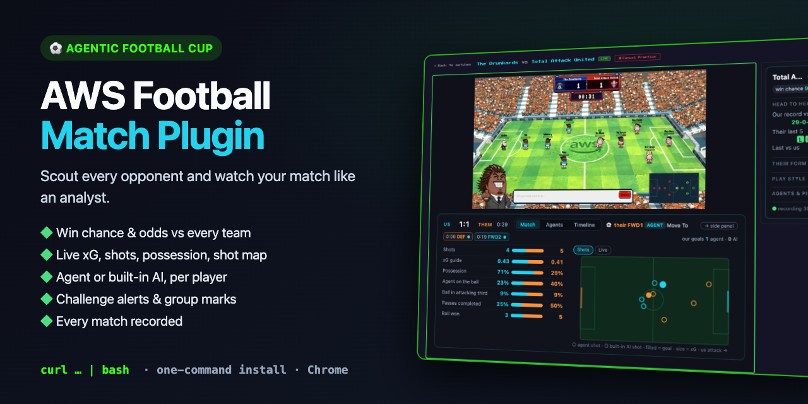
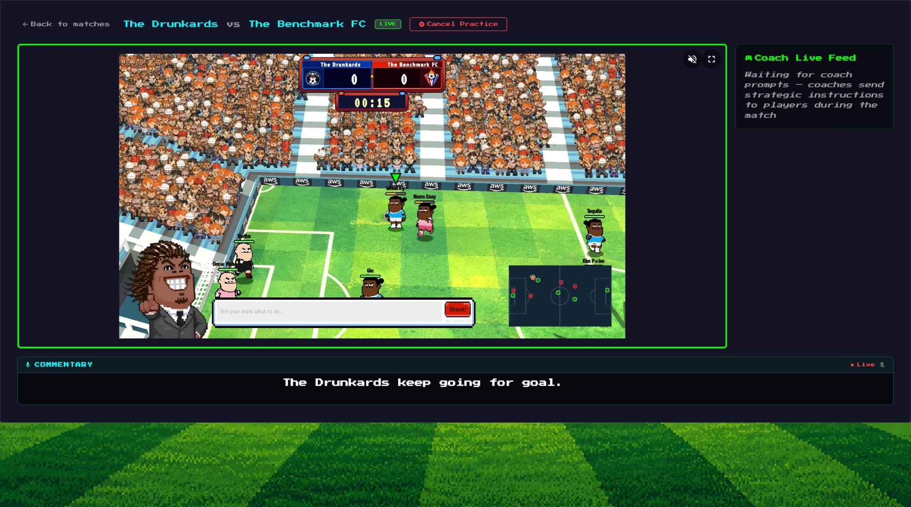
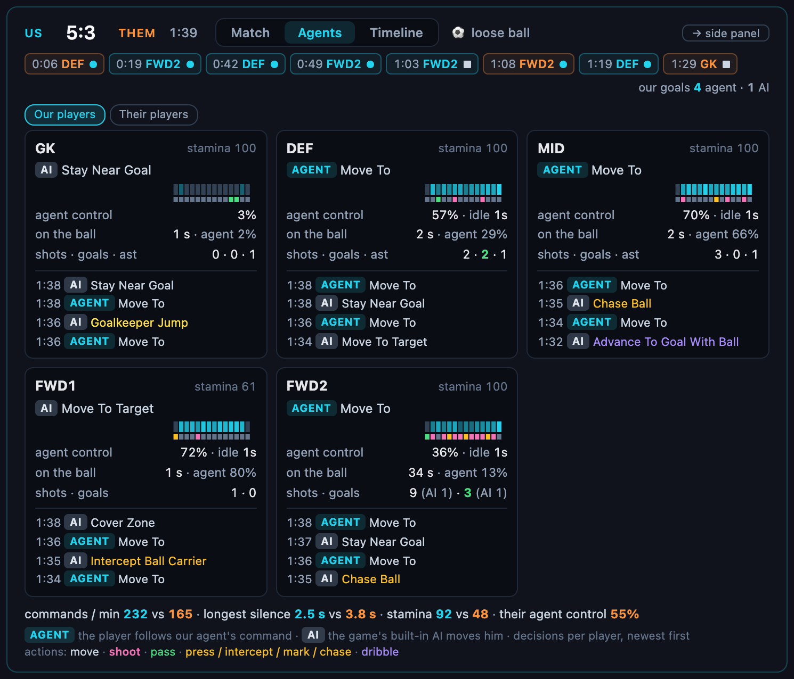
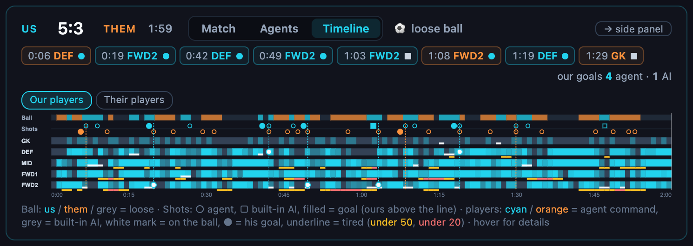

<div align="center">

# ⚽ AWS Football Match Plugin

**Scout every opponent, never lose a match recording, and never miss a challenge in the Agentic Football Cup.**




</div>

---

<p align="center"><b>⭐ If it helps your team, give it a star — it helps other teams find it.</b></p>

## 🆕 What's new since 1.43

- **Three tabs under the game** — *Match* (stats + shot map or a live pitch), *Agents* (a card per player) and
  *Timeline* (the whole match, second by second).
- **Who scored, and who decided** — every goal as a chip: scorer, the pass before it, and whether your agent or the
  game's built-in AI took the shot. Same at full time in the summary.
- **Their players too** — the *Agents* and *Timeline* tabs switch between your team and the opponent's.
- **Stamina** — a ⚡ tired chip for your players under 20, tired stretches underlined on the timeline.
- **Actions coloured by kind** — move, shoot, pass, press, dribble — on the cards and the ball line.
- **The opponent's tactics and agent health** this match, from the portal; a calmer side panel with folded blocks.
- **Find match** marks a team that is busy in a match right now.
- Fixes: *Day summary* counts your own team's W-D-L (it counted only ours), long rows and the ping table fit a
  narrow side panel.

## 👀 The same match, without and with the plugin

<table>
<tr>
<th width="50%">Without</th>
<th width="50%">With the plugin</th>
</tr>
<tr>
<td></td>
<td></td>
</tr>
<tr>
<td valign="top">

- the game picture
- *Coach Live Feed* waiting for prompts
- one line of commentary

</td>
<td valign="top">

- **under the game:** score, clock, who has the ball, every goal (scorer, pass, agent or game AI) and three tabs —
  **Match**, **Agents**, **Timeline**
- **on the right:** win chance, the opponent's place and win rate, your record against them, their last 5
- the live score on the plugin's icon, a summary at the final whistle, the match saved to a file

</td>
</tr>
</table>

---

## 🚀 Install in one minute

Paste this into Terminal (macOS / Linux):

```bash
curl -fsSL https://raw.githubusercontent.com/shusachenko/aws-football-match-plugin/main/install.sh | bash
```

Chrome then opens `chrome://extensions` with the path already copied. Three clicks, first time only:

1. **Developer mode** — the toggle at the top right
2. **Load unpacked**
3. **Cmd+Shift+G → Cmd+V → Enter → Select**

That's it. **Updates are one click:** when a new version is out, the popup shows a green **Update to vX** button
at the top — press it and the plugin installs the new version and reloads itself.

> ♻️ **Coming from a version before 1.33?** Run the install command once more, then — one time only — click
> **Remove** on the old card in `chrome://extensions` and **Load unpacked** the same folder again (the plugin now
> has a fixed ID so the updater can talk to it). From then on, updates are the button.

> 🪟 **Windows / no Terminal:** grab the zip from [Releases](https://github.com/shusachenko/aws-football-match-plugin/releases/latest), unzip it,
> run `Install.bat` (Mac: `Install.command`, the first time right-click → Open), then the same three clicks.
>
> 💡 **Tip:** `chrome://settings/downloads` → turn off *Ask where to save each file before downloading*,
> so match files save silently.

---

## ✨ Why you'll want it

| | |
|---|---|
| 🎲 **Your win chance** | Before you challenge and during the match: the chance to win, draw or lose against that team, with fair odds. |
| 🔍 **Scouting panel in the viewer** | The opponent's place in the table, win rate overall and **against you**, your record and goals, the last result — while the match is on. |
| 🎯 **Smarter opponent picking** | Every team in *Find match* shows its rank, win rate overall and **win rate against you**, so you challenge the right teams. |
| 📼 **Every match recorded** | Ball, all 10 players and their actions ~40× a second, the commentary, the portal's report and a screenshot of the final score — saved by themselves. |
| 🔔 **Never miss a challenge** | A macOS notification and a card with **Accept** and a countdown. One click accepts and opens the viewer. |
| ▶️ **Auto-START** | Presses the viewer's START screen for you. Optional, off by default. |
| 📶 **Agents' ping at a glance** | Average and p99 latency per position, yours and the opponent's. |
| 🤖 **Agent or game AI?** | See live which of your players follow an agent command and which the game's own AI moves. |
| 📊 **This match, live** | Under the game, in three tabs: stats + shot map, a card per agent, and a whole-match timeline. Every goal says who scored and whether your agent or the game's built-in AI took the shot. |
| 🏁 **Score on the icon + summary** | The live score on the plugin icon; at full time a summary: result, xG, shots, silent agents. |
| 📈 **Form at a glance** | The opponent's last 5 results and 24-hour trend; your own form per block of 10 matches in the popup. |
| 🛎️ **A chime you can't miss** | A sound every 12 s and a flashing portal tab while a challenge waits. |
| ⚑ **Your group, marked** | Load your tournament group as JSON: its teams are marked everywhere, plus a mini table. |
| ⬆️ **One-click updates** | A green *Update* button when a new version is out; it installs and reloads by itself. |
| 🎥 **Records even unwatched** | A match of yours with no viewer open gets one in a background tab, closed after the save. |
| 🔒 **Private by design** | Runs only on agentic-football.aws.dev, uses your own portal session, sends nothing anywhere. |

---

## 🔍 Scouting, right where you play

<table>
<tr>
<td width="50%" valign="top">

### Find match, with numbers

Open **Find opponent** and every team already tells you how it stands:

- `⚑ D` — the team is in your tournament group ([load your group](#-your-tournament-group))
- `● in match` — the team is playing right now (challenge it and you wait)
- `#24` — place in the tournament table
- `43%` — their win rate overall (red from 60%, yellow from 45%)
- `vs us 3-0-3` — their wins-draws-losses against **you** (red when they beat you half the time or more,
  yellow from a quarter)
- `win 79%` — your chance to beat them (hover for draw / lose and the odds)

Hover a badge for the full story: record, goals and the last result against you.

Works while you type in the search box too.

</td>
<td width="50%"></td>
</tr>
</table>

### The match, live — under the game

A wide strip inside the game's frame, from kick-off to the final whistle. Always on top:

- **score and clock**, and **who has the ball right now** — "⚽ MID · AGENT Move To" or "⚽ MID · AI Advance To
  Goal With Ball": your agent's command or the game's built-in AI;
- **every goal** as a small chip — time, scorer and a dot: cyan circle = your agent's shot, grey square = the game's
  built-in AI; **hover** it for the distance and the pass before it (agent or AI) — plus "our goals 5 agent · 1 AI".

Three tabs (the last one you opened is remembered):



- **Match** — shots, an **xG guide**, possession, **agent on the ball** (how much of the time your carrier follows an
  agent command), ball in the attacking third, passes completed, ball won — one row each, cyan = you, orange =
  them; next to it a **shot map** (○ agent shot, □ built-in AI shot, filled = goal, size = xG) or the **Live** pitch
  (filled dot = agent command, hollow = game AI, white ring = on the ball);
- **Agents** — a card per player (GK, DEF, MID, FWD1, FWD2): who moves him now, a 40 s strip (cyan =
  agent, grey = AI), stamina, agent control, time on the ball and its agent share, shots / goals / assists, and **his
  own last decisions** ("0:57 AGENT Shoot", "0:56 AI Chase Ball"), each action coloured by kind — move grey, shoot
  pink, pass green, press / intercept / mark / chase yellow, dribble violet; the card of the player on the ball is outlined;
  under the cards: commands per minute, the longest silence and stamina for both teams; a red line on top if the
  portal reports errors for one of your agents; **Our players / Their players** switches the cards to the opponent
  (their new commands seen in the game stream instead of your decisions); under the 40 s strip a thin second strip shows the **kind of action** each second (grey
  move, pink shoot, green pass, yellow press / intercept / mark, violet dribble); a red **⚡ tired** chip in the top
  line names any of your players under 20 stamina;
- **Timeline** — the whole match second by second: who held the ball, every shot and goal, and a lane per player
  (cyan = agent command, grey = game AI, white mark = on the ball); **hover** a shot or goal for who took it, or any
  second of a lane for who had the ball / how much the agent commanded that player and his stamina; a yellow / red
  underline marks a tired player (under 50 / under 20); **Our players / Their players** switches the lanes to the
  opponent's team.



Before kick-off it simply says *waiting*. **→ side panel** moves it into the right column if you prefer.

### The opponent panel

The viewer's right column (in place of the empty Coach Live Feed) keeps only what you need at a glance: your
**win chance**, the opponent's **place** and **win rate** (chips under the name), **your record against them**,
**their last 5** results (W = they won, L = they lost), the **last match** between you and their coach's tactics this
match. The rest sits in three folded blocks: **Their form** (win / draw / lose odds, their record, 24 h form, goals
per game), **Play style** (theirs and yours side by side, one row per command type, plus commands a match and
ping) and **Agents & ping** (agent health when the portal has it, your agents' ping). A green **● REC** by the name
shows the recording; a one-line footer says how far it got. **▾** folds the whole panel to show the Coach Live
Feed. It appears whether you started the match yourself or accepted a challenge.

### At the final whistle

The plugin's icon shows the live score (green ahead, red behind) while you play. At full time a notification
sums it up — *Won 3:2 vs Feyenoord · xG 2.1:1.3 · shots 11:6 · possession 54%* — and names any agent that went
silent for 20+ s; the popup's **Last match** card shows the same with bars.

---

## ⚑ Your tournament group

Load your group once and its teams get a purple **⚑ D** mark everywhere on the portal — the leaderboard, match
lists, *Find match*, incoming challenges (card and notification) and the match panel — so you always know which
matches count for the table. Load **every group** and the other teams get a grey letter (**B**) too. The
*Settings* tab then also shows your group as a small table: place, win rate and your record against each team.

**How to load it**

1. Click the plugin's icon → **⚙ Settings** → **My group** → **Load group…**
2. Paste the JSON below (or **From file…** to pick a `.json` file) → **Save**.

Open game tabs pick it up within a minute. **Clear** removes it.

**Format** — one object with the group's name and the other teams' names:

```json
{
  "name": "D",
  "teams": [
    "Team Alpha",
    "Goal Diggers",
    "Byte FC"
  ]
}
```

| Field | What | Rules |
|---|---|---|
| `name` | the group's name, shown as *⚑ GROUP D* | text, 1–30 characters |
| `teams` | the teams in your group | 1–40 names, written as the portal shows them; capitals and a *(human)* tag are ignored |

**Every group at once** — to see each team's group on the leaderboard, list all groups and say which one is yours:

```json
{
  "mine": "D",
  "groups": {
    "A": ["Team Alpha", "Goal Diggers"],
    "B": ["Byte FC", "Null Pointers"],
    "D": ["Offside Trap", "Kick Stack"]
  }
}
```

| Field | What | Rules |
|---|---|---|
| `mine` | the name of your group | one of the keys in `groups` |
| `groups` | every group: name → its teams | 1–40 groups, each with 1–40 team names |

Your own team in the list does no harm. The group stays in your Chrome only.

---

## 🧰 The popup


Click the extension's icon. On top of every tab: **incoming challenges** (who is calling, their numbers, a
countdown, **Accept** and **🔇** to silence the chime) and **Update** next to the version.

| Tab | What's there |
|---|---|
| **Match** | this match: recording, report and score screenshot, each ✓ when saved, plus warnings · **Last match**: result, shots, xG, possession, goals by agent / built-in AI, silent agents · **Stop & save**, **Screenshot**, **Folder**, **Day summary** · your agents' **ping** |
| **Form** | **Our form**: W-D-L, win rate and goals per block of 10 matches (real opponents only) · **Recent matches** with ✓/✗ per file — click one to open its report |
| **⚙ Settings** | the switches (Auto-START, Auto-accept, Chime, Record in background, Save portal data) · **My group** with its table |

---

## 🎲 How the win chance is worked out

Both teams' overall win rates are combined with the classic **log5** formula (the chance that A beats B when A wins
`a` of its games and B wins `b`), draws take the two teams' average draw share, and your head-to-head record nudges
the result (it counts like 8 extra games at the estimate). Fair odds = 1 / chance. Checked on 69 real matches: the
likeliest outcome was right 64% of the time. It is an estimate, not a promise — agents change between matches.

---

## 📼 What gets saved

Open the match viewer **before kick-off** and recording starts by itself (REC on the icon). After the final
whistle, in `Downloads/agentic-football-matches/`:

| File | What it is |
|---|---|
| `match-<id>.json.gz` | The whole match: ball, all 10 players and their actions ~40× a second, game events, commentary |
| `report-<id>.txt` | The portal's match report, with the AI summary |
| `final-<id>.png` | A screenshot of the final score with both team names — proof of the result |

A page reload or a dropped connection mid-match does not break the recording.

---

## ⚙️ Switches

**▶️ Auto-START** (off by default). START is only the viewer's title screen: the match starts on the server
anyway and the title screen stays until it is clicked. With the switch on and the viewer tab visible, the
plugin looks for the orange START button on the game picture and clicks it, then stops as soon as the game
shows. It never accepts challenges.

**✅ Auto-accept challenges** (off by default). Every new incoming challenge is accepted by itself, the viewer
opens and you get a notification. Check your tournament's rules first: some rounds require every challenge to be
accepted by hand. Built-in safeguards:

- once switched on, it lasts only until **23:59 that day** and then turns itself off;
- it needs an open portal tab (agentic-football.aws.dev), which it checks every 3 s.

**🛎️ Chime on challenge** (on). Three notes when a challenge comes in, again every 12 s while it waits; the
portal tab's title flashes too. **🔇** on the challenge (popup or notification) silences that one.

**🎥 Record in background** (on). A match of yours that no tab shows — accepted in the portal's own banner,
started from another device — gets its viewer in a background tab, so it is recorded; the tab closes itself after
the save.

**💾 Save portal data** (off). Writes the portal's table and your matches to `portal.json` in the matches folder,
for your own scripts. Most people don't need it.

---

## 🔒 Privacy

- Runs only on `agentic-football.aws.dev`.
- Reads the portal's API with **your own signed-in session in the page**; the token never leaves the page.
- Files go to your Downloads folder only. No servers, no analytics, no tracking.
- The updater (`updater.pl`, installed next to the plugin) does one thing: when you press *Update*, it runs this
  repo's own installer. Chrome lets only this plugin start it.
- Screenshots used to find the START button are looked at in memory and never saved.

---

## ❓ Troubleshooting

| Problem | Fix |
|---|---|
| No panel in the viewer | Reload the viewer tab once after installing or updating. |
| Chrome asks where to save every file | `chrome://settings/downloads` → turn off *Ask where to save each file before downloading*. |
| No challenges or table in the popup | Keep a portal tab open and signed in (any page of agentic-football.aws.dev). |
| Auto-START does not press | The viewer tab must be visible. The panel's *Auto-START:* line says what it sees. |
| macOS: "Install.command can't be opened" | Right-click it → **Open** → **Open** (once). |

<div align="center">
<sub>Made by The Drunkards for the Agentic Football Cup · not affiliated with AWS</sub>
</div>
