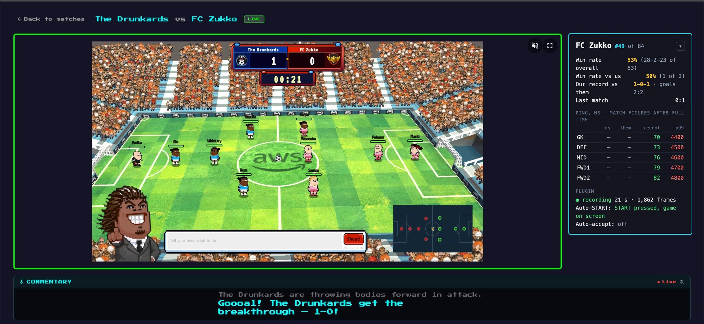
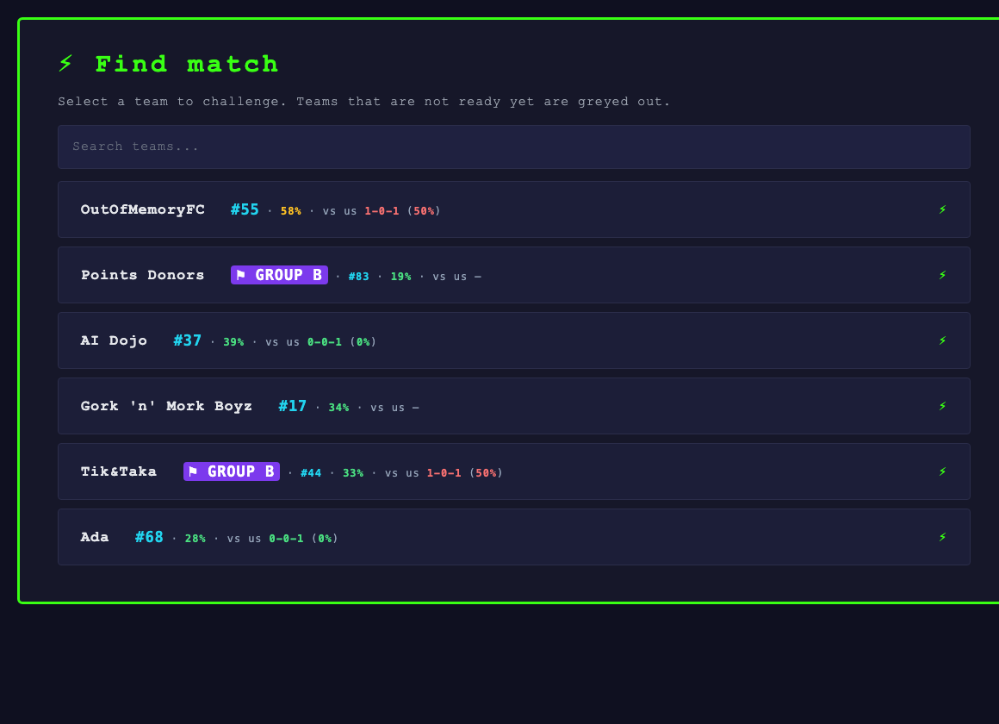
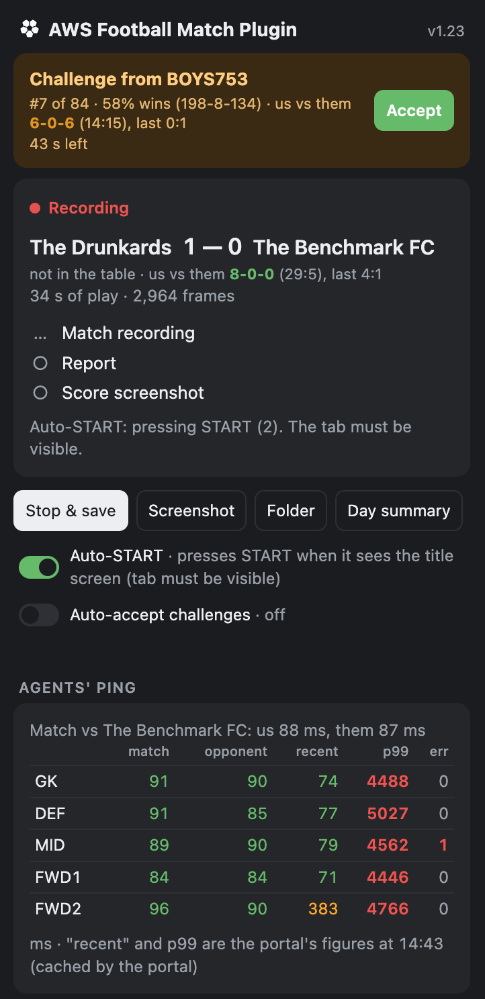

<div align="center">

# ⚽ AWS Football Match Plugin

**Scout every opponent, never lose a match recording, and never miss a challenge in the Agentic Football Cup.**




<sub>The live match viewer. On the right, in place of the empty Coach Live Feed: everything you want to know about the opponent.</sub>

</div>

---

## 🚀 Install in one minute

Paste this into Terminal (macOS / Linux):

```bash
curl -fsSL https://raw.githubusercontent.com/shusachenko/aws-football-match-plugin/main/install.sh | bash
```

Chrome then opens `chrome://extensions` with the path already copied. Three clicks, first time only:

1. **Developer mode** — the toggle at the top right
2. **Load unpacked**
3. **Cmd+Shift+G → Cmd+V → Enter → Select**

That's it. **Updates are one click:** when a new version is out, the popup shows a green **Update to vX** button
at the top — press it and the plugin installs the new version and reloads itself.

> ♻️ **Coming from a version before 1.33?** Run the install command once more, then — one time only — click
> **Remove** on the old card in `chrome://extensions` and **Load unpacked** the same folder again (the plugin now
> has a fixed ID so the updater can talk to it). From then on, updates are the button.

> 🪟 **Windows / no Terminal:** grab the zip from [Releases](https://github.com/shusachenko/aws-football-match-plugin/releases/latest), unzip it,
> run `Install.bat` (Mac: `Install.command`, the first time right-click → Open), then the same three clicks.
>
> 💡 **Tip:** `chrome://settings/downloads` → turn off *Ask where to save each file before downloading*,
> so match files save silently.

---

## ✨ Why you'll want it

| | |
|---|---|
| 🔍 **Scouting panel in the viewer** | The opponent's place in the table, win rate overall and **against you**, your record and goals, the last result — while the match is on. |
| 🎯 **Smarter opponent picking** | Every team in *Find match* shows its rank, win rate overall and **win rate against you**, so you challenge the right teams. |
| 📼 **Every match recorded** | Ball, all 10 players and their actions ~40× a second, the commentary, the portal's report and a screenshot of the final score — saved by themselves. |
| 🔔 **Never miss a challenge** | A macOS notification and a card with **Accept** and a countdown. One click accepts and opens the viewer. |
| ▶️ **Auto-START** | Presses the viewer's START screen for you. Optional, off by default. |
| 📶 **Agents' ping at a glance** | Average and p99 latency per position, yours and the opponent's. |
| 📊 **This match, live** | Shots, xG, possession and attacking-third time as numbers and bars, plus a shot map. |
| 🏁 **Score on the icon + summary** | The live score on the plugin icon; at full time a summary: result, xG, shots, silent agents. |
| 📈 **Form at a glance** | The opponent's last 5 results and 24-hour trend; your own form per block of 10 matches in the popup. |
| 🛎️ **A chime you can't miss** | A sound every 12 s and a flashing portal tab while a challenge waits. |
| ⬆️ **One-click updates** | A green *Update* button when a new version is out; it installs and reloads by itself. |
| 🎥 **Records even unwatched** | A match of yours with no viewer open gets one in a background tab, closed after the save. |
| 🔒 **Private by design** | Runs only on agentic-football.aws.dev, uses your own portal session, sends nothing anywhere. |

---

## 🔍 Scouting, right where you play

<table>
<tr>
<td width="50%" valign="top">

### Find match, with numbers

Open **Find opponent** and every team already tells you how it stands:

- `#24` — place in the tournament table
- `43%` — their win rate overall (red from 60%, yellow from 45%)
- `vs us 3-0-3 (50%)` — their wins-draws-losses against **you**, and how often they beat you
  (red from 50%, yellow from 25%)

Hover a badge for the full story: record, goals and the last result against you.

Works while you type in the search box too.

</td>
<td width="50%"></td>
</tr>
</table>

### The match panel

During a match the viewer's right column shows the opponent's **place**, **win rate overall** and
**against you**, **your record and goals**, the **last match**, **ping per position** for both teams and
what the plugin is doing (recording, Auto-START, Auto-accept). An **agents live** table shows, per position, how
much of the last 30 s each player spent on an agent command, for both teams, and how long your player has been
without one: a silent or slow agent shows at once. Above it, **this match live**: shots, an xG guide,
possession and how much the ball sits in each side's attacking third. Under the win rates, the opponent's
**form**: their last 5 results and whether they are rising or falling over the last 24 h. Press **▾** to fold it into a strip and
see the Coach Live Feed again. It appears whether you started the match yourself or accepted a challenge.

---

## 🧰 The popup

<table>
<tr>
<td width="44%"></td>
<td width="56%" valign="top">

Click the extension's icon:

- **Incoming challenges** — who is calling, their numbers, a countdown and **Accept**
- **This match** — recording, report and score screenshot, each ✓ when saved, plus warnings
  (late start, silent socket, reloads)
- **Stop & save**, **Screenshot**, **Folder**, **Day summary** (copies today's matches as a table, with your W-D-L)
- **Auto-START**, **Auto-accept**, **Chime on challenge** and **Record in background** switches
- **Our form** — W-D-L, win rate and goals per block of 10 matches, real opponents only
- **Update** — at the top, next to the version: installs a new version in one click
- **🔇** on a ringing challenge — silence it (new challenges still ring)
- **Agents' ping** — this match for both teams, plus the portal's recent average and p99
- **Recent matches** with ✓/✗ per file — click one to open its report and fill in what is missing

</td>
</tr>
</table>

---

## 📼 What gets saved

Open the match viewer **before kick-off** and recording starts by itself (REC on the icon). After the final
whistle, in `Downloads/agentic-football-matches/`:

| File | What it is |
|---|---|
| `match-<id>.json.gz` | The whole match: ball, all 10 players and their actions ~40× a second, game events, commentary |
| `report-<id>.txt` | The portal's match report, with the AI summary |
| `final-<id>.png` | A screenshot of the final score with both team names — proof of the result |

A page reload or a dropped connection mid-match does not break the recording.

---

## ⚙️ Switches

**▶️ Auto-START** (off by default). START is only the viewer's title screen: the match starts on the server
anyway and the title screen stays until it is clicked. With the switch on and the viewer tab visible, the
plugin looks for the orange START button on the game picture and clicks it, then stops as soon as the game
shows. It never accepts challenges.

**✅ Auto-accept challenges** (off by default, **for practice days only**). Every new incoming challenge is
accepted by itself, the viewer opens and you get a notification. Built-in safeguards:

- once switched on, it lasts only until **23:59 that day** and then turns itself off;
- it **cannot be switched on and never accepts on the tournament days (28–29 Oct)** — the tournament rules
  say every challenge is accepted by hand there; the check runs before every single accept;
- it needs an open portal tab (agentic-football.aws.dev), which it checks every 3 s.

---

## 🔒 Privacy

- Runs only on `agentic-football.aws.dev`.
- Reads the portal's API with **your own signed-in session in the page**; the token never leaves the page.
- Files go to your Downloads folder only. No servers, no analytics, no tracking.
- The updater (`updater.pl`, installed next to the plugin) does one thing: when you press *Update*, it runs this
  repo's own installer. Chrome lets only this plugin start it.
- Screenshots used to find the START button are looked at in memory and never saved.

---

## ❓ Troubleshooting

| Problem | Fix |
|---|---|
| No panel in the viewer | Reload the viewer tab once after installing or updating. |
| Chrome asks where to save every file | `chrome://settings/downloads` → turn off *Ask where to save each file before downloading*. |
| No challenges or table in the popup | Keep a portal tab open and signed in (any page of agentic-football.aws.dev). |
| Auto-START does not press | The viewer tab must be visible. The panel's *Auto-START:* line says what it sees. |
| macOS: "Install.command can't be opened" | Right-click it → **Open** → **Open** (once). |

<div align="center">
<sub>Made by The Drunkards for the Agentic Football Cup · not affiliated with AWS</sub>
</div>
